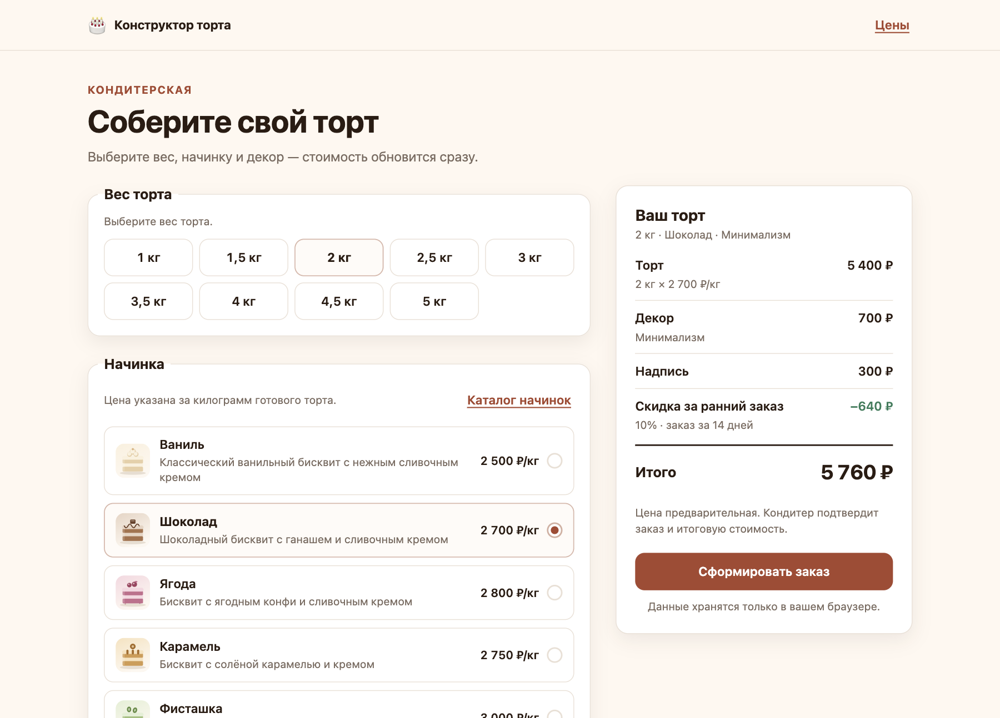
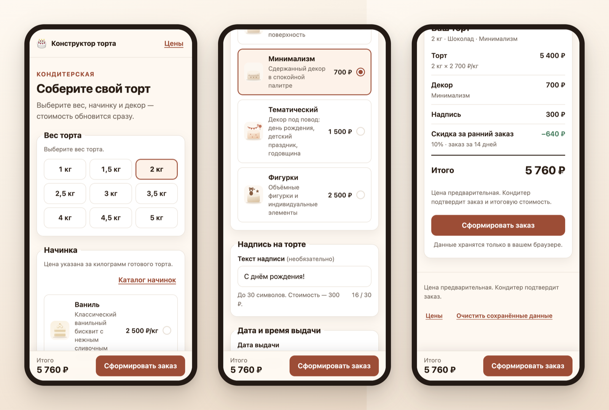

# 🎂 Cake Constructor

**A single-page web calculator that lets a customer build a cake, see the price instantly, and get a ready-to-paste order card for a messenger — without waiting for the pastry chef to reply.**

[](https://elstar883.github.io/cake-constructor/)
[](LICENSE)
[](#tech-stack)
[](#tech-stack)
[](#tech-stack)
[](#tech-stack)

> 🇬🇧 English · 🇷🇺 [Русский](README.md)

### 👉 [Open the live demo](https://elstar883.github.io/cake-constructor/)

> **Note:** the product interface is in Russian — it is built for a small Russian pastry shop. This document is an English overview for portfolio purposes.

---

## Table of contents

- [About the project](#about-the-project)
- [Screenshots](#screenshots)
- [Features](#features)
- [How the price is calculated](#how-the-price-is-calculated)
- [Prices and parameters](#prices-and-parameters)
- [Rules and limits](#rules-and-limits)
- [Tech stack](#tech-stack)
- [Project structure](#project-structure)
- [Run locally](#run-locally)
- [Configuring prices](#configuring-prices)
- [Accessibility and responsiveness](#accessibility-and-responsiveness)
- [Documentation](#documentation)
- [License](#license)

---

## About the project

**The problem.** A customer cannot tell how much a cake will cost until they message the pastry chef. The chef then spends time on the same clarifications over and over: weight, filling, decor, date, price. The customer takes longer to decide, and the chef handles more back-and-forth than necessary.

**The solution.** A web calculator that covers the whole path to a finished request on a single screen:

1. The customer picks weight, filling, decor, an inscription and a date.
2. The price recalculates instantly, with a transparent line-by-line breakdown.
3. The app validates the input and builds an order card.
4. The card is copied with one click and pasted into the chat with the chef.

**The result.** The customer sees the price immediately instead of waiting for a reply. The chef receives a fully filled-in request with no repeated questions.

The project runs entirely in the browser: no backend, no build step, no dependencies and no network requests.

## Screenshots

**Desktop** — form on the left, live breakdown and total on the right:



**Mobile** — the form, the filling and decor pickers, and the total with the footer; three screens in a row:

<p align="center">
  
</p>

<sub>Full-page screenshot — [`docs/screenshots/mobile.png`](docs/screenshots/mobile.png).</sub>

## Features

- **Live recalculation** — the price updates on every change, with no "Calculate" button.
- **Transparent breakdown** — separate lines for Cake, Decor, Inscription, Discount and Total; the line items always add up to the total.
- **Early-booking discount** — 5% for pickup in 7–13 days and 10% for 14 days or more.
- **Strict validation** — weight, date, time, name, contact and inscription length are checked with clear hints.
- **Order card** — ready-to-send text with every parameter and the price breakdown.
- **One-click copy** — via the Clipboard API, with a fallback for older browsers.
- **Draft and last order** — stored in `localStorage` and restored after a reload.
- **Filling and decor catalogs** — with local SVG illustrations, no external images.
- **"Prices" screen** — a customer-friendly table of prices and conditions.
- **One settings file** — the chef changes prices and limits in `js/config.js`; the UI picks them up automatically.
- **Works offline** — the core scenario needs no network.

## How the price is calculated

```
cake        = weight × filling price per kg
decor       = fixed decor price
inscription = 300 ₽ if the inscription is filled in
base        = cake + decor + inscription
discount    = −round(base × percent / 100)
total       = cake + decor + inscription + discount
```

Key rules:

- All amounts are whole rubles; every line is rounded with `Math.round`.
- The total is the sum of the **already rounded** lines, so the breakdown can never disagree with the total.
- The discount is rounded once and stored as a negative number.
- The price does not depend on the name, contact or comment.

**Early-booking discount:**

| Days before pickup | Discount |
| --- | --- |
| 2–6 | — |
| 7–13 | 5% |
| 14–60 | 10% |

**Example.** A 2 kg chocolate cake with "Minimalist" decor, an inscription and pickup in 14 days:

| Line | Amount |
| --- | --- |
| Cake: 2 kg × 2,700 ₽/kg | 5,400 ₽ |
| "Minimalist" decor | 700 ₽ |
| Inscription | 300 ₽ |
| Early-booking discount 10% | −640 ₽ |
| **Total** | **5,760 ₽** |

## Prices and parameters

**Fillings** — price per kilogram of the finished cake:

| Filling | Price | Description |
| --- | --- | --- |
| Vanilla | 2,500 ₽/kg | Classic vanilla sponge with a delicate butter cream |
| Chocolate | 2,700 ₽/kg | Chocolate sponge with ganache and butter cream |
| Berry | 2,800 ₽/kg | Sponge with berry confit and butter cream |
| Caramel | 2,750 ₽/kg | Sponge with salted caramel and cream |
| Pistachio | 3,000 ₽/kg | Pistachio sponge with pistachio-paste cream |

**Decor** — fixed price per cake:

| Decor | Price | Description |
| --- | --- | --- |
| No decor | 0 ₽ | A neat cream finish |
| Minimalist | 700 ₽ | Restrained decor in a calm palette |
| Themed | 1,500 ₽ | Decor for the occasion: birthday, kids' party, anniversary |
| Figures | 2,500 ₽ | Three-dimensional figures and custom elements |

**General parameters:**

| Parameter | Value |
| --- | --- |
| Weight | 1–5 kg, 0.5 kg steps |
| Inscription | 300 ₽, up to 30 characters |
| Minimum lead time | 2 calendar days |
| Booking horizon | 60 calendar days |
| Pickup time | 10:00–19:00, 30-minute steps |
| Fulfilment | Pickup |
| Currency | Russian rubles, whole numbers |

The current values live in [`js/config.js`](js/config.js) and on the "Prices" screen — that is the single source of prices.

## Rules and limits

The interface messages below are the actual Russian strings shown to the user.

| Field | Rule | What happens on error |
| --- | --- | --- |
| Weight | 1 to 5 kg | "Выберите вес от 1 до 5 кг." |
| Filling | required | "Выберите начинку." |
| Decor | required | "Выберите декор." |
| Date | no earlier than 2 days ahead, no later than 60 days | "Минимальный срок заказа — 2 дня. Ближайшая дата: …" |
| Time | 10:00–19:00, 30-minute steps | "Выберите время с 10:00 до 19:00." |
| Inscription | no longer than 30 characters | Character counter and blocked submission |
| Name | 2–50 characters | "Укажите имя." |
| Contact | an 11-digit phone number (starting with `7` or `8`) or a Telegram username of 5–32 characters | "Укажите телефон или Telegram." |

On error the app shows a list of problems and moves focus to the first invalid field. Entered data is never cleared.

## Tech stack

- **HTML5** — semantic markup, `<dialog>`, `<fieldset>`.
- **CSS3** — custom properties, Flexbox, Grid, `clamp()`, mobile-first, `safe-area-inset`.
- **Vanilla JavaScript** — classic scripts, IIFEs and a single `window.CakeApp` namespace.
- **`localStorage`** — draft and last order (every access wrapped in `try/catch`).
- **No frameworks, no build, no dependencies** — opens directly via `file://` and works without a network.

## Project structure

```text
.
├── index.html              # markup for screens and modals
├── css/
│   └── styles.css          # styles, variables, responsiveness
├── js/
│   ├── config.js           # the single source of prices and limits
│   ├── pricing.js          # price calculation, rounding, date handling
│   ├── order.js            # validation, order card, clipboard copy
│   └── app.js              # state, DOM, catalogs, localStorage
├── docs/
│   ├── PROJECT_PASSPORT.md # project passport (Russian)
│   ├── TZ.md               # technical specification (Russian)
│   └── screenshots/        # UI screenshots
├── AGENTS.md               # development and UI rules (Russian)
├── LICENSE
└── README.md
```

Scripts are loaded in order: `config.js` → `pricing.js` → `order.js` → `app.js`, all with the `defer` attribute.

## Run locally

No build and no dependency install required.

**Option 1.** Double-click `index.html`.

**Option 2** (recommended — clipboard copying works correctly this way):

```bash
python3 -m http.server 8000
```

Then open <http://localhost:8000>.

## Configuring prices

Every price, description, weight option, lead time and pickup hour lives in a single file — [`js/config.js`](js/config.js).

- Filling and decor names, the "Prices" screen and the catalogs are all generated from the config — no prices are hard-coded in the markup.
- To add a filling or decor, just append an object to the array: the UI picks it up with no changes to HTML or CSS.
- After editing the file, simply reload the page.

Example of adding a filling:

```js
{
  id: "new-filling",
  name: "New filling",
  pricePerKg: 2600,           // multiple of 50 ₽
  description: "A short, clear description",
  visual: { style: "cream", from: "#fbf0dd", to: "#e8cfa6", accent: "#d9a86a" },
}
```

## Accessibility and responsiveness

- Mobile-first, verified at 375 px and 1440 px; no horizontal scrolling.
- Every interactive element is at least 44 px.
- Semantic elements, a `label` for every field, errors linked via `aria-describedby`.
- The total and the copy status use `aria-live="polite"`.
- Full keyboard navigation, a visible focus ring, modals close on `Esc`.
- `prefers-reduced-motion` is respected.

## Documentation

- [Project passport](docs/PROJECT_PASSPORT.md) — why the product exists, MVP scope, metrics *(Russian)*.
- [Technical specification](docs/TZ.md) — requirements, calculations, limits, acceptance criteria *(Russian)*.
- [AGENTS.md](AGENTS.md) — development, code and UI rules *(Russian)*.

## License

Released under the [MIT License](LICENSE).
