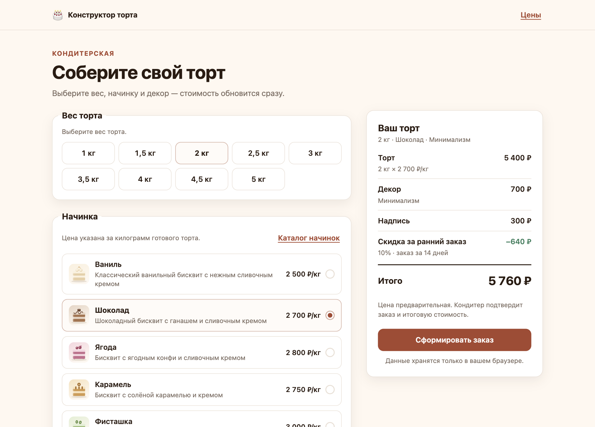
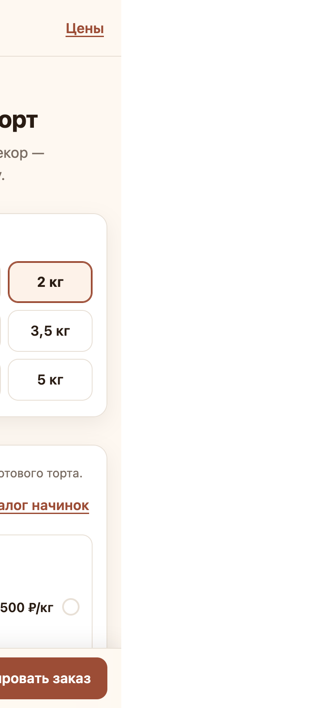

# 🎂 Конструктор торта

> 🇷🇺 Русский · 🇬🇧 [English](README.en.md)

**Одностраничный веб-калькулятор, который позволяет покупателю собрать торт, сразу увидеть стоимость и получить готовую карточку заказа для мессенджера — без переписки с кондитером.**

[](https://elstar883.github.io/cake-constructor/)
[](LICENSE)
[](#технологии)
[](#технологии)
[](#технологии)
[](#технологии)

### 👉 [Открыть живое демо](https://elstar883.github.io/cake-constructor/)

---

## Содержание

- [О проекте](#о-проекте)
- [Скриншоты](#скриншоты)
- [Возможности](#возможности)
- [Как считается стоимость](#как-считается-стоимость)
- [Цены и параметры](#цены-и-параметры)
- [Правила и ограничения](#правила-и-ограничения)
- [Технологии](#технологии)
- [Структура проекта](#структура-проекта)
- [Запуск локально](#запуск-локально)
- [Настройка цен для кондитера](#настройка-цен-для-кондитера)
- [Доступность и адаптивность](#доступность-и-адаптивность)
- [Документация](#документация)
- [Лицензия](#лицензия)

---

## О проекте

**Проблема.** Покупатель не понимает, сколько будет стоить торт, пока не напишет кондитеру. Кондитер тратит время на одни и те же уточнения: вес, начинка, декор, дата, цена. В итоге покупатель дольше решает, а кондитер обрабатывает больше переписки, чем нужно.

**Решение.** Веб-калькулятор, который за один экран закрывает весь путь до готового запроса:

1. Покупатель выбирает вес, начинку, декор, надпись и дату.
2. Стоимость пересчитывается мгновенно, с прозрачной расшифровкой по пунктам.
3. Приложение проверяет данные и формирует карточку заказа.
4. Карточка копируется одним нажатием и вставляется в чат с кондитером.

**Результат.** Покупатель сразу видит цену и не ждёт ответа. Кондитер получает полностью заполненный запрос без повторяющихся уточнений.

Проект работает полностью в браузере: без серверной части, сборки, зависимостей и сетевых запросов.

## Скриншоты

**Десктоп** — форма слева, живая расшифровка и итог справа:



**Мобильный** — итог и кнопка закреплены внизу экрана:

<p align="center">
  
</p>

## Возможности

- **Живой пересчёт** — стоимость обновляется при каждом изменении параметров, без кнопки «Рассчитать».
- **Прозрачная расшифровка** — отдельные строки «Торт», «Декор», «Надпись», «Скидка» и «Итого»; сумма строк всегда совпадает с итогом.
- **Скидка за ранний заказ** — 5% при выдаче через 7–13 дней и 10% через 14 дней и более.
- **Строгая валидация** — вес, дата, время, имя, контакт и длина надписи проверяются с понятными подсказками.
- **Карточка заказа** — готовый текст со всеми параметрами и расшифровкой.
- **Копирование одним нажатием** — через Clipboard API с запасным вариантом для старых браузеров.
- **Черновик и последний заказ** — сохраняются в `localStorage` и восстанавливаются после перезагрузки.
- **Каталоги начинок и декора** — с локальными SVG-иллюстрациями, без внешних изображений.
- **Экран «Цены»** — понятная покупателю таблица цен и условий.
- **Один файл настроек** — кондитер меняет цены и ограничения в `js/config.js`, интерфейс подхватывает их автоматически.
- **Работает офлайн** — базовый сценарий не требует сети.

## Как считается стоимость

```
cake        = вес × цена начинки за кг
decor       = фиксированная цена декора
inscription = 300 ₽, если надпись заполнена
base        = cake + decor + inscription
discount    = −round(base × процент / 100)
total       = cake + decor + inscription + discount
```

Ключевые правила:

- Все суммы — целые рубли, каждая строка округляется через `Math.round`.
- Итог — сумма **уже округлённых** строк, поэтому расшифровка никогда не расходится с итогом.
- Скидка округляется один раз и хранится отрицательным числом.
- Цена не зависит от имени, контакта и комментария.

**Скидка за ранний заказ:**

| Дней до выдачи | Скидка |
| --- | --- |
| 2–6 | — |
| 7–13 | 5% |
| 14–60 | 10% |

**Пример.** 2 кг шоколадного торта с декором «Минимализм», надписью и выдачей через 14 дней:

| Строка | Сумма |
| --- | --- |
| Торт: 2 кг × 2 700 ₽/кг | 5 400 ₽ |
| Декор «Минимализм» | 700 ₽ |
| Надпись | 300 ₽ |
| Скидка за ранний заказ 10% | −640 ₽ |
| **Итого** | **5 760 ₽** |

## Цены и параметры

**Начинки** — цена за килограмм готового торта:

| Начинка | Цена | Описание |
| --- | --- | --- |
| Ваниль | 2 500 ₽/кг | Классический ванильный бисквит с нежным сливочным кремом |
| Шоколад | 2 700 ₽/кг | Шоколадный бисквит с ганашем и сливочным кремом |
| Ягода | 2 800 ₽/кг | Бисквит с ягодным конфи и сливочным кремом |
| Карамель | 2 750 ₽/кг | Бисквит с солёной карамелью и кремом |
| Фисташка | 3 000 ₽/кг | Фисташковый бисквит с кремом из фисташковой пасты |

**Декор** — фиксированная стоимость за торт:

| Декор | Цена | Описание |
| --- | --- | --- |
| Без декора | 0 ₽ | Аккуратная кремовая поверхность |
| Минимализм | 700 ₽ | Сдержанный декор в спокойной палитре |
| Тематический | 1 500 ₽ | Декор под повод: день рождения, детский праздник, годовщина |
| Фигурки | 2 500 ₽ | Объёмные фигурки и индивидуальные элементы |

**Общие параметры:**

| Параметр | Значение |
| --- | --- |
| Вес | 1–5 кг, шаг 0,5 кг |
| Надпись | 300 ₽, до 30 символов |
| Минимальный срок заказа | 2 календарных дня |
| Горизонт заказа | 60 календарных дней |
| Время самовывоза | 10:00–19:00, шаг 30 минут |
| Способ получения | Самовывоз |
| Валюта | Рубли, целые числа |

Актуальные значения хранятся в [`js/config.js`](js/config.js) и на экране «Цены» — это единственный источник цен.

## Правила и ограничения

| Поле | Правило | Что происходит при ошибке |
| --- | --- | --- |
| Вес | от 1 до 5 кг | «Выберите вес от 1 до 5 кг.» |
| Начинка | обязательна | «Выберите начинку.» |
| Декор | обязателен | «Выберите декор.» |
| Дата | не раньше чем через 2 дня, не позже 60 дней | «Минимальный срок заказа — 2 дня. Ближайшая дата: …» |
| Время | 10:00–19:00, шаг 30 минут | «Выберите время с 10:00 до 19:00.» |
| Надпись | не длиннее 30 символов | Счётчик символов и блокировка отправки |
| Имя | 2–50 символов | «Укажите имя.» |
| Контакт | телефон из 11 цифр (первая `7` или `8`) или Telegram username 5–32 символа | «Укажите телефон или Telegram.» |

При ошибке показывается список проблем, а фокус переходит к первому проблемному полю. Введённые данные не очищаются.

## Технологии

- **HTML5** — семантическая разметка, `<dialog>`, `<fieldset>`.
- **CSS3** — переменные, Flexbox, Grid, `clamp()`, mobile-first, `safe-area-inset`.
- **Ванильный JavaScript** — классические скрипты, IIFE и единое пространство имён `window.CakeApp`.
- **`localStorage`** — черновик и последний заказ (все обращения в `try/catch`).
- **Без фреймворков, сборки и зависимостей** — открывается напрямую через `file://` и работает без сети.

## Структура проекта

```text
.
├── index.html              # разметка экранов и модальных окон
├── css/
│   └── styles.css          # стили, переменные, адаптивность
├── js/
│   ├── config.js           # единственный источник цен и ограничений
│   ├── pricing.js          # расчёт стоимости, округление, работа с датами
│   ├── order.js            # валидация, сборка карточки, копирование
│   └── app.js              # состояние, DOM, каталоги, localStorage
├── docs/
│   ├── PROJECT_PASSPORT.md # паспорт проекта
│   ├── TZ.md               # техническое задание
│   └── screenshots/        # скриншоты интерфейса
├── AGENTS.md               # правила разработки и интерфейса
├── LICENSE
├── README.en.md            # английская версия README
└── README.md
```

Скрипты подключаются по порядку: `config.js` → `pricing.js` → `order.js` → `app.js` с атрибутом `defer`.

## Запуск локально

Сборка и установка зависимостей не нужны.

**Вариант 1.** Открыть `index.html` двойным кликом.

**Вариант 2** (рекомендуется — так корректно работает копирование в буфер обмена):

```bash
python3 -m http.server 8000
```

Затем открыть <http://localhost:8000>.

## Настройка цен для кондитера

Все цены, описания, варианты веса, сроки и часы выдачи находятся в одном файле — [`js/config.js`](js/config.js).

- Названия начинок и декора, экран «Цены» и каталоги генерируются из конфига — в вёрстке цен нет.
- Чтобы добавить начинку или декор, достаточно дописать объект в массив: интерфейс подхватит его без правок HTML и CSS.
- После изменения файла достаточно обновить страницу.

Пример добавления начинки:

```js
{
  id: "new-filling",
  name: "Новая начинка",
  pricePerKg: 2600,           // кратно 50 ₽
  description: "Короткое понятное описание",
  visual: { style: "cream", from: "#fbf0dd", to: "#e8cfa6", accent: "#d9a86a" },
}
```

## Доступность и адаптивность

- Mobile-first, проверено на 375 px и 1440 px; горизонтальной прокрутки нет.
- Все интерактивные элементы не меньше 44 px.
- Семантические элементы, подписи `label` у каждого поля, ошибки связаны через `aria-describedby`.
- Итог и статус копирования — `aria-live="polite"`.
- Полная клавиатурная навигация, видимый фокус, модальные окна закрываются по `Esc`.
- Учитывается `prefers-reduced-motion`.

## Документация

- [Паспорт проекта](docs/PROJECT_PASSPORT.md) — зачем нужен продукт, границы MVP, метрики.
- [Техническое задание](docs/TZ.md) — требования, расчёты, ограничения, критерии приёмки.
- [AGENTS.md](AGENTS.md) — правила разработки, кода и интерфейса.

## Лицензия

Проект распространяется по лицензии [MIT](LICENSE).
